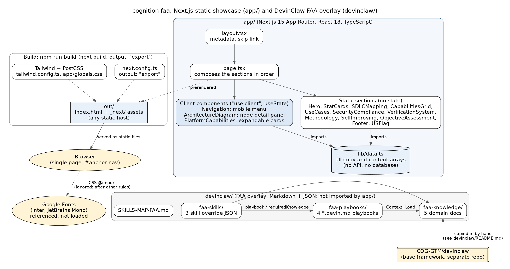

# cognition-faa

A single-page showcase of Cognition's Devin + orchestrator platform for FAA application and database modernization, plus the DevinClaw FAA overlay (knowledge, playbooks and skill configs).

| Path | What it is |
|------|------------|
| `app/` | Next.js 15 (App Router) + React 18 + Tailwind CSS site, exported as static HTML. Section content (cards, lists, node details) lives in `app/lib/data.ts`; headings and the hero copy are inline in the components. |
| `devinclaw/` | FAA overlay for [COG-GTM/devinclaw](https://github.com/COG-GTM/devinclaw). Markdown and JSON only; the site does not import it. See [devinclaw/README.md](devinclaw/README.md). |
| `docs/` | [Architecture](docs/architecture.md) and the Graphviz diagram source. |



Diagram source: [`docs/diagrams/architecture.dot`](docs/diagrams/architecture.dot) ([SVG](docs/diagrams/architecture.svg)). Full write-up: [docs/architecture.md](docs/architecture.md).

## Run it locally

Needs Node.js 18.18 or newer (checked on Node 20) and npm. There are no environment variables, API keys, backend or database.

```bash
npm ci
npm run dev        # http://localhost:3000, hot reload
```

## Build

```bash
npm run build      # type-checks, then writes the static site to out/
npx serve@latest out   # or any static file server
```

`next.config.ts` sets `output: "export"`, so `npm run build` produces plain files in `out/` that any static host can serve. `npm start` (`next start`) does **not** work with this setting: it exits with `"next start" does not work with "output: export" configuration`. Serve `out/` instead.

## Checks

- There is no test suite and no `test` script.
- `npm run build` runs the TypeScript check (`npx tsc --noEmit` does the same on its own).
- `npm run lint` (`next lint`) is not configured: the repo has no ESLint config or ESLint dependency, so it stops at an interactive "How would you like to configure ESLint?" prompt.

## Using the page

The site is one page (`/`). The top navigation and the hero buttons jump to section anchors (`#architecture`, `#platform`, `#capabilities`, ...). Three parts are interactive:

- **System Architecture**: click (or press Enter on) a node to open its detail panel; click it again or CLOSE to hide it.
- **Platform**: click a capability card to expand its highlights.
- **Navigation** below the `md` breakpoint: MENU opens the link list, CLOSE hides it.

## Editing content

Change card, list and detail text in `app/lib/data.ts`; each section component in `app/components/` renders exported arrays from it. Section headings, the hero headline and buttons, and the footer are written inline in their components. Section order is set in `app/page.tsx`. Colors and fonts are in `tailwind.config.ts` and `app/globals.css` (fonts load from Google Fonts at runtime).

To change the architecture diagram, edit `docs/diagrams/architecture.dot` and run `docs/diagrams/render.sh` (needs Graphviz: `sudo apt-get install graphviz`), then commit the `.dot`, `.png` and `.svg` together.
