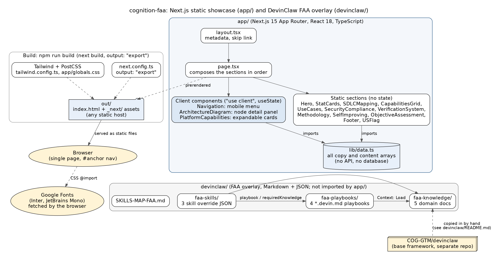

# Architecture

`cognition-faa` holds two independent things:

1. **`app/`**: a static, single-page Next.js site that presents Devin + orchestrator for FAA modernization.
2. **`devinclaw/`**: an FAA overlay (Markdown knowledge, playbooks, JSON skill overrides) meant to be copied into the separate [COG-GTM/devinclaw](https://github.com/COG-GTM/devinclaw) framework.

Nothing in `app/` reads `devinclaw/`, and nothing in `devinclaw/` is executable here.

Source: [`diagrams/architecture.dot`](diagrams/architecture.dot), rendered to [PNG](diagrams/architecture.png) and [SVG](diagrams/architecture.svg) by [`diagrams/render.sh`](diagrams/render.sh).

## The site (`app/`)

### Stack

| Layer | Choice | Where |
|-------|--------|-------|
| Framework | Next.js 15 App Router (`next ^15.0.0`, lockfile 15.5.x) | `package.json` |
| UI | React 18, TypeScript (strict) | `tsconfig.json` |
| Styling | Tailwind CSS 3 + PostCSS + Autoprefixer, custom `faa-blue` palette, Inter / JetBrains Mono | `tailwind.config.ts`, `postcss.config.mjs`, `app/globals.css` |
| Output | Static export (`output: "export"`) to `out/` | `next.config.ts` |

There is no API route, server action, middleware, environment variable, database or external API call. The only runtime network request besides the site's own files is the Google Fonts stylesheet `@import`ed in `app/globals.css`.

### Rendering

- `app/layout.tsx` sets page metadata (title, description, keywords) and a "Skip to main content" link.
- `app/page.tsx` renders `Navigation`, then the sections inside `<main id="main-content">` in this order, then `Footer`:

| Section component | Anchor id | Data from `app/lib/data.ts` |
|-------------------|-----------|-----------------------------|
| `Hero` | `hero` | (inline copy) |
| `StatCards` | `challenge` | `stats` |
| `ArchitectureDiagram` | `architecture` | `architectureNodes` |
| `PlatformCapabilities` | `platform` | `platformCapabilities` |
| `SDLCMapping` | `sdlc` | `sdlcPhases` |
| `CapabilitiesGrid` | `capabilities` | `capabilities` |
| `UseCases` | `use-cases` | `useCases` |
| `SecurityCompliance` | `security` | `securityPlatforms`, `complianceFrameworks` |
| `VerificationSystem` | `verification` | `verificationFeatures` |
| `Methodology` | `methodology` | `methodologyPhases`, `methodologyBenefits` |
| `SelfImproving` | `self-improving` | `selfImprovingSteps`, `selfImprovingTimeline` |
| `ObjectiveAssessment` | `assessment` | `objectiveStrengths`, `objectiveLimitations` |

`Navigation` reads `navLinks`; `Hero`, `Navigation` and `Footer` render the `USFlag` SVG.

- Every page is prerendered at build time. Three components are client components (`"use client"`) because they hold UI state with `useState`:
  - `Navigation`: open/closed state of the mobile menu.
  - `ArchitectureDiagram`: which node of the inline SVG diagram is selected; the selected node's `description` shows in a detail panel. Nodes are focusable and respond to Enter/Space.
  - `PlatformCapabilities`: which capability card is expanded.
- All other components are server components with no state.

### Navigation

The page has no routes besides `/` (and Next's generated 404). Navigation is in-page: `navLinks` and the hero buttons link to the anchor ids above, and `html { scroll-behavior: smooth }` in `globals.css` animates the jump. The fixed nav bar is 56 px tall (`h-14`); sections start below it.

### Build and deploy

`npm run build` compiles, type-checks and writes `out/index.html`, `out/404.html` and `out/_next/` assets. Serve `out/` with any static host. `next start` refuses to run with `output: "export"`. The repo contains no deployment config or CI workflow.

## The FAA overlay (`devinclaw/`)

| Path | Contents |
|------|----------|
| `faa-knowledge/` | `notam-formats.md`, `aixm-standards.md`, `faa-coding-conventions.md`, `faa-tech-stack.md`, `faa-systems-inventory.md` |
| `faa-playbooks/` | `analyze-faa-legacy`, `migrate-faa-oracle`, `faa-security-audit`, `faa-swim-integration` (`*.devin.md`) |
| `faa-skills/` | `faa-legacy-analysis.json`, `faa-db-rationalization.json`, `faa-security-scan.json` |
| `SKILLS-MAP-FAA.md` | Maps DevinClaw skills to FAA systems and scenarios |

Each skill JSON names the base `skill` it tunes, FAA `intentPhrases`, the `requiredKnowledge` files and the `playbook` to run. Each playbook's **Context** section lists the knowledge files to load. These references are relative paths inside the overlay.

The overlay is applied by copying it into a checkout of `COG-GTM/devinclaw` (steps in [devinclaw/README.md](../devinclaw/README.md)). The base framework keeps its own `skills/`, `knowledge/` and `playbooks/` directories; the `faa-*` directories sit next to them.
